<p align="center">
  <a href="https://eclat-auto.djason-chery.dev" title="Ouvrir la démo en ligne d'Éclat Auto"></a>
</p>

<p align="center">
  <a href="https://eclat-auto.djason-chery.dev" title="Ouvrir la démo en ligne"></a>
  
  
  
  
  
  <a href="LICENSE" title="Lire la licence"></a>
</p>

<p align="center">
  <a href="https://eclat-auto.djason-chery.dev" title="Ouvrir la démo en ligne"><b>VOIR LA DÉMO</b></a> &nbsp;&nbsp;·&nbsp;&nbsp;
  <a href="#ce-que-montre-la-démo" title="Aller aux fonctionnalités"><b>FONCTIONNALITÉS</b></a> &nbsp;&nbsp;·&nbsp;&nbsp;
  <a href="docs/fr/architecture.md" title="Lire la documentation en français"><b>DOCUMENTATION</b></a> &nbsp;&nbsp;·&nbsp;&nbsp;
  <a href="README.md" title="Read this page in English"><b>ENGLISH</b></a>
</p>

# Éclat Auto

[English](README.md "Read this page in English") · **Français**

Site de démonstration d'**Éclat Auto**, une station de lavage et d'esthétique automobile **fictive** à Nantes :
prestations et tarifs, prise de rendez-vous en ligne en 6 étapes, espace client, offre pour les professionnels et
administration complète.

C'est un projet de portfolio de [Djason CHERY](https://djason-chery.dev "Site de Djason CHERY") : la refonte, en
SvelteKit, d'un vrai site réalisé auparavant, dont toute trace du vrai client a été remplacée par du contenu inventé.
**Rien n'est réel** : l'entreprise, les personnes, l'adresse, les avis et les chiffres sont inventés, les paiements et
les e-mails sont simulés.

Le design garde l'esprit du site d'origine (noir, gris clair et or, titres italiques en gras, découpes en biais de
l'original) dans une version plus haut de gamme, sans aucune autre forme en biais.

**Démo en ligne : [eclat-auto.djason-chery.dev](https://eclat-auto.djason-chery.dev "Ouvrir la démo en ligne")**

## Ce que montre la démo

| Partie | Fonctionnalités |
| --- | --- |
| Accueil | Haut de page avec badges de confiance et carte « Le plus choisi », « Comment ça marche » en 4 étapes, tarifs par catégorie, avant / après d'un phare à faire glisser (souris, doigt ou clavier), options, avis (fictifs, dit sur la page), offre pro, questions fréquentes, bandeau final |
| Prestations | Filtres par catégorie, formules comparées côte à côte (badge « Recommandé »), suppléments selon la taille du véhicule, options à la carte |
| Rendez-vous | 6 étapes : service, véhicule (pictogrammes, prix ajusté) et formule, options à cocher, informations, calendrier du mois avec heures libres groupées matin / après-midi, récapitulatif modifiable et paiement simulé. Le total suit en direct (panneau à droite, barre en bas sur téléphone). Confirmation avec fichier agenda `.ics` et aperçu de l'e-mail |
| Professionnels | Atouts, trois formules (ponctuel, abonnement flotte, concession), cartes par métier, étapes, chiffres et témoignage fictifs, questions des pros, demande de devis |
| Connexion | Fenêtre « Connexion / Inscription » (mot de passe oublié simulé), comptes de démo en un clic |
| Mon compte | Tableau de bord (prochain rendez-vous, réservations à venir, soins réalisés, total réglé), informations, documents (images compressées dans le navigateur), réservations avec annulation, suppression du compte |
| Administration | Chiffres clés, réservations (filtres par statut, recherche, confirmation, annulation), utilisateurs, calendrier des créneaux et horaires de la semaine (interrupteur Ouvert / Fermé), tarifs, messages |
| Pages d'information | Horaires et accès (plan dessiné, sans service tiers), contact, mentions légales, confidentialité, CGV et cookies avec sommaire, page 404 |
| Ce que comprend ce site | Page `/fonctionnalites/` (bannière de démo et pied de page) : toutes les fonctions par partie (vitrine, réservation, espace client, administration, pros et contact, pages légales, qualité), chacune avec un lien direct vers son écran ou vers la fenêtre de connexion, ce qui est simulé et ce qui deviendrait réel, puis « Vous voulez le même site ? » |
| Outils de la démo | Bannière « Site de démonstration » avec « Ce que comprend ce site », visite guidée et « Remettre à zéro » |

<table>
  <tr>
    <th width="50%">Rendez-vous : véhicule et formule</th>
    <th width="50%">Rendez-vous : date et heure</th>
  </tr>
  <tr>
    <td width="50%">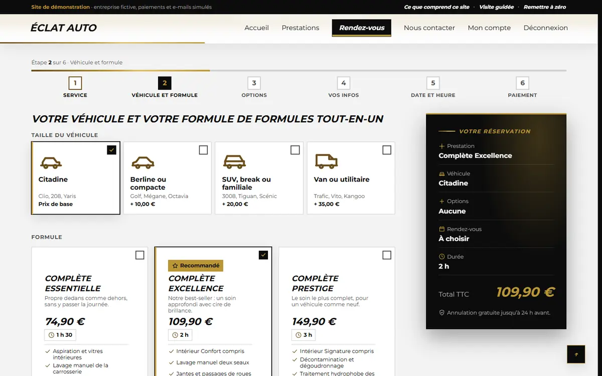</td>
    <td width="50%">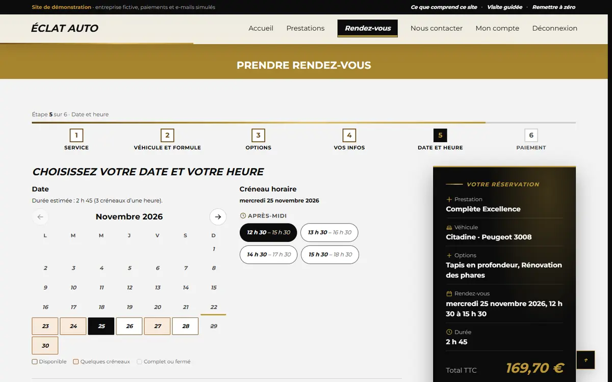</td>
  </tr>
  <tr>
    <th width="50%">Rendez-vous : récapitulatif</th>
    <th width="50%">Confirmation</th>
  </tr>
  <tr>
    <td width="50%">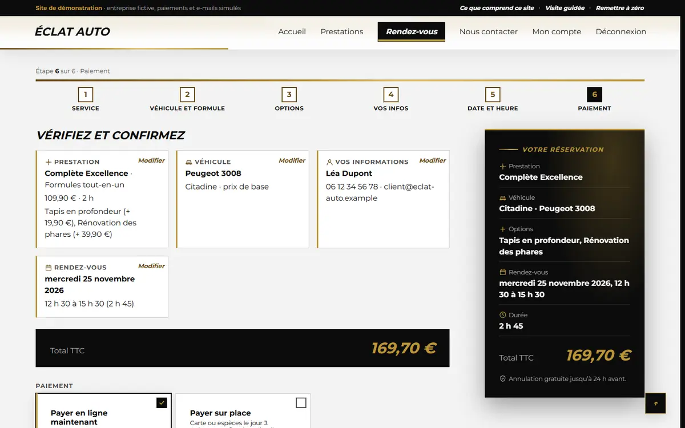</td>
    <td width="50%">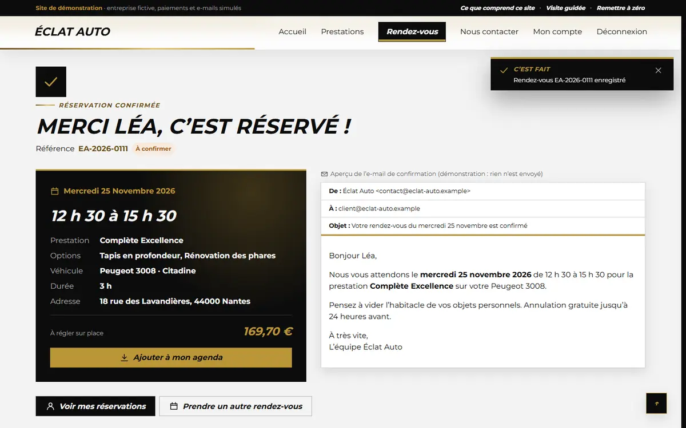</td>
  </tr>
  <tr>
    <th width="50%">Prestations</th>
    <th width="50%">Professionnels</th>
  </tr>
  <tr>
    <td width="50%">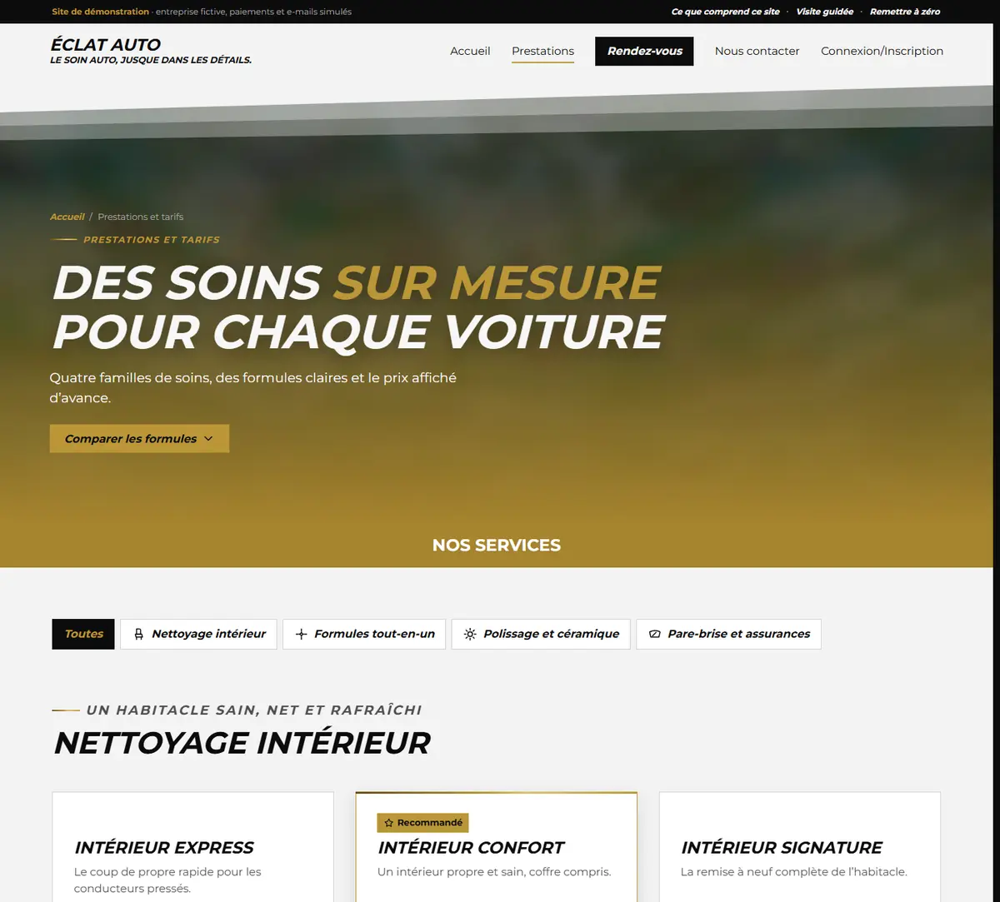</td>
    <td width="50%">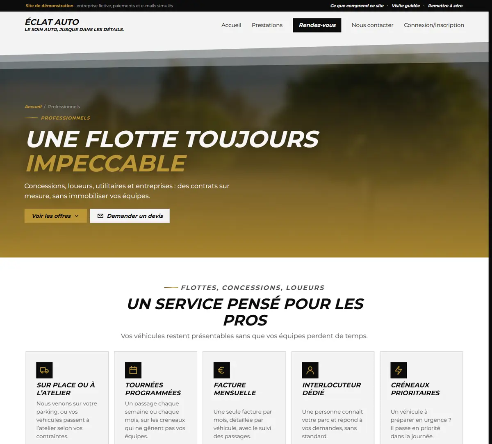</td>
  </tr>
  <tr>
    <th width="50%">Horaires et accès</th>
    <th width="50%">Ce que comprend ce site</th>
  </tr>
  <tr>
    <td width="50%">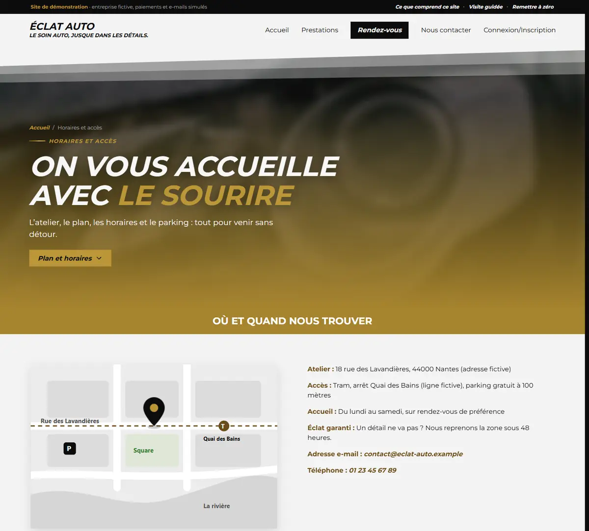</td>
    <td width="50%">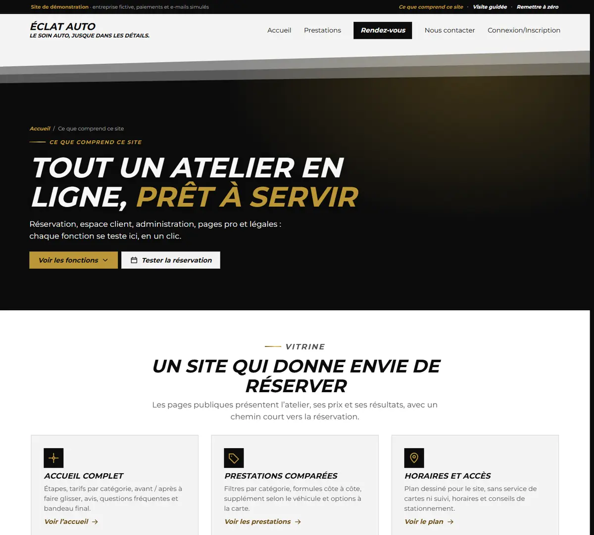</td>
  </tr>
  <tr>
    <th width="50%">Mon compte</th>
    <th width="50%">Administration</th>
  </tr>
  <tr>
    <td width="50%">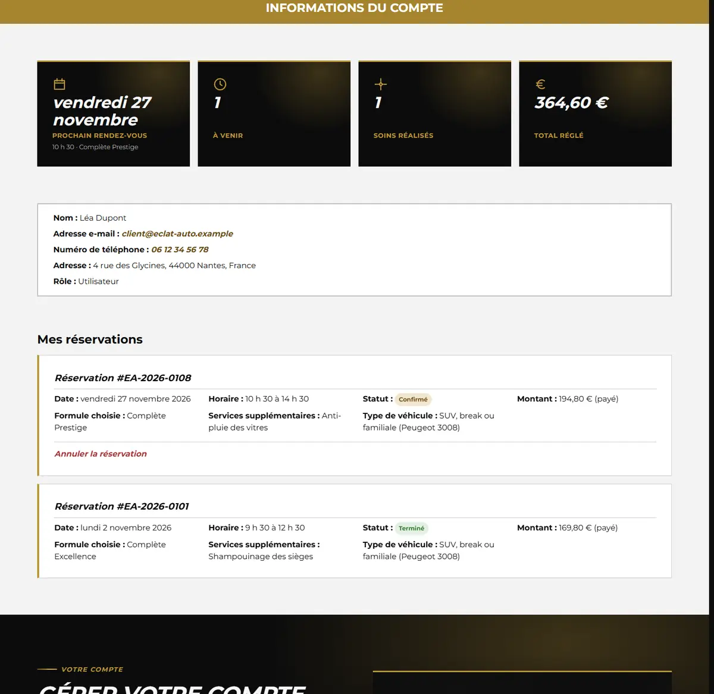</td>
    <td width="50%">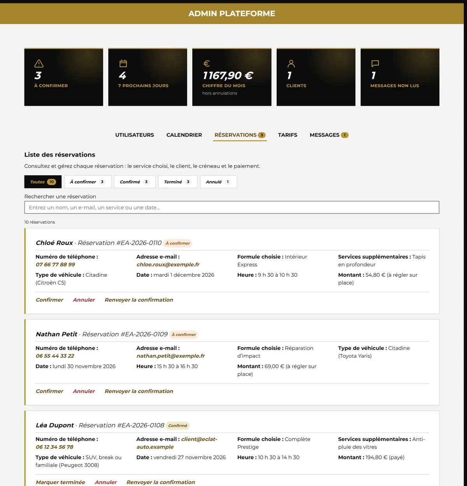</td>
  </tr>
</table>

<table>
  <tr>
    <th width="50%">Téléphone</th>
    <th width="50%">Menu</th>
  </tr>
  <tr>
    <td width="50%" align="center">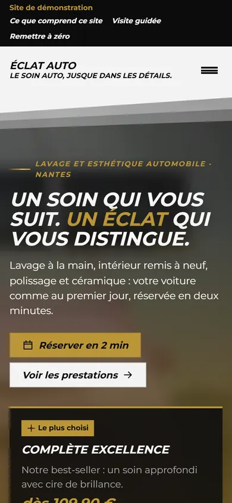</td>
    <td width="50%" align="center">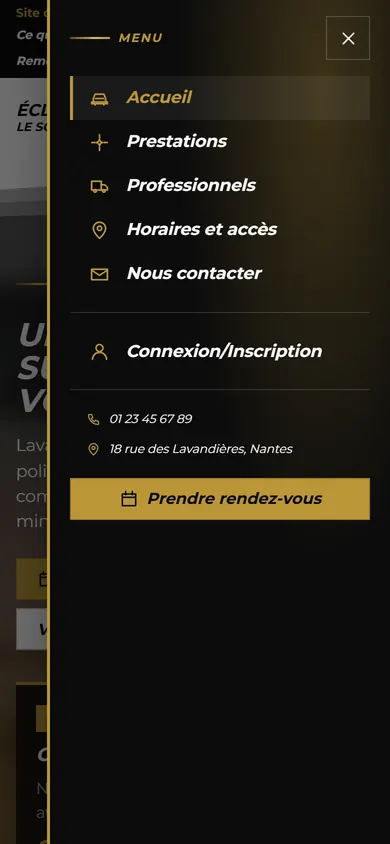</td>
  </tr>
</table>

### Ce qui est simulé

Il n'y a ni serveur ni base de données. Les comptes, les réservations, les créneaux, les tarifs, les messages et les
réglages de l'administration vivent dans le `localStorage` du navigateur (préfixe `eclat-auto:`), avec les mêmes
règles qu'une vraie application (créneaux vraiment libres, annulation jusqu'à 24 heures avant, rôles client et admin).
Les mots de passe sont gardés sous forme d'empreinte SHA-256. Les e-mails ne partent jamais : un aperçu est montré.
« Remettre à zéro », en haut de chaque page, remet les données de départ. Détails :
[docs/fr/couche-de-demo.md](docs/fr/couche-de-demo.md "Couche de démo").

### Comptes de démo

Aussi en boutons dans la fenêtre de connexion.

| Rôle | E-mail | Mot de passe |
| --- | --- | --- |
| Client | `client@eclat-auto.example` | `Demo-Client-2026` |
| Admin | `admin@eclat-auto.example` | `Demo-Admin-2026` |

Cartes de test du paiement simulé : `4242 4242 4242 4242` est acceptée, `4000 0000 0000 0002` est refusée. Aucun
prestataire de paiement n'est contacté.

## Stack

- [SvelteKit](https://svelte.dev "SvelteKit") et Svelte 5 (runes), en **TypeScript** strict, exporté en **site
  statique** (`adapter-static`) : ni serveur, ni base de données
- État dans des stores Svelte (`src/lib/stores/`) et leurs actions (`stores/actions/`), données dans le `localStorage`
- CSS simple avec des jetons de design (`src/lib/assets/css/utils/variables.css`), police Montserrat hébergée avec le
  site, icônes SVG intégrées
- Structure de **[DC Scaffold](https://tools.djason-chery.dev/fr/scaffold/ "Découvrir DC Scaffold")**, le générateur de
  projets de l'auteur (un fichier par page, vues dans `components/views/`, composants réutilisables dans
  `components/ui/`)

## Lancer le site

Il faut Node.js 20 ou plus récent.

```bash
cd frontend
npm install
npm run dev        # http://localhost:3000
```

Sous Windows, `start.bat` puis `D` fait la même chose (et installe ce qui manque). macOS et Linux : `./start.sh`.

Les réglages sont dans `frontend/.env` (développement) et `frontend/.env.production` (build) : copier
`frontend/.env.example`. Ils contiennent seulement le nom et l'adresse du site ; aucun secret n'est nécessaire.

## Scripts et contrôles

À lancer dans `frontend/`. Tous doivent finir sans erreur ni avertissement.

| Commande | Rôle |
| --- | --- |
| `npm run dev` | Site de développement sur http://localhost:3000 |
| `npm run check` | Types (svelte-check, TypeScript strict), plus les deux contrôles ci-dessous |
| `npm run check:images` | Chaque photo de `static/images/` sert à un seul endroit, aucune n'est en double ni inutilisée |
| `npm run check:tokens` | Aucune taille de texte ni espacement écrit à la main hors de `variables.css` |
| `npm run lint` | ESLint |
| `npm run build` | Site statique dans `frontend/build/`, avec `sitemap.xml`, `robots.txt`, `_headers` (CSP) et `404.html` |

## Dossiers

```text
frontend/
  src/routes/                 une page par dossier (adresses en français : /prestations/, /reservation/...)
  src/lib/components/layout/  cadre des pages : en-tête, menu mobile, pied de page
  src/lib/components/ui/      composants réutilisables (boutons, cartes, héros, sections, fenêtres, champs...)
  src/lib/components/views/   contenu de chaque page (Home, Booking, Pros, Account, Admin, Legal...)
  src/lib/content/            textes et données : entreprise, catalogue, photos et crédits, accueil, pros
  src/lib/demo/               données de départ et stockage local de la démo
  src/lib/stores/             état de l'application et ses actions (session, réservation, admin, fenêtres)
  src/lib/utils/              outils : formats, créneaux, validation, fichier .ics, apparitions...
  src/lib/assets/css/         styles : jetons, base, un fichier par famille de composants
  static/                     photos, police, icônes, _headers de Cloudflare Pages
  scripts/                    contrôles (images, jetons), sitemap, CSP
docs/                         documentation détaillée (fr, en) et captures
```

Plus de détails : [docs/fr/architecture.md](docs/fr/architecture.md "Architecture").

## Règles de mise en page (conventions du site)

- **Jetons partout** : toute taille de texte (`--font-*`) et tout espacement (`--space-*`, marges, retraits, écarts,
  positions) vient de `utils/variables.css`. `npm run check` le vérifie (`npm run check:tokens`) et refuse une valeur écrite à la main.
- **Une photo, un endroit** : chaque photo de `static/images/` sert à un seul endroit (`npm run check:images`).
- **Rangées de cartes alignées** : dans une rangée de cartes, les mêmes parties sont à la même hauteur (badge, titre,
  texte, prix et durée, liste, bouton en bas). Le conteneur prend la classe `aligned-cards` avec `--card-rows` (nombre de
  parties) et chaque carte la classe `aligned-card` : les cartes partagent les lignes de la grille (`grid-template-rows: subgrid`,
  `assets/css/components/premium.css`). Une partie absente (badge « Recommandé » d'une seule carte) garde sa place avec
  un `<span class="card-slot"></span>`. Pour une carte de choix (réservation) : `<ChoiceCard aligned>`.
- **Liens** : jamais soulignés ; dans un texte, couleur d'accent et gras (`text-link`, ou `icon-link` avec un picto) ;
  le lien vers la page courante porte `aria-current="page"` ; jamais de lien entre parenthèses.
- **Survol et appui** : seulement à la souris, dans `@media (hover: hover) and (pointer: fine)`.
- **Erreurs de formulaire** : une notification avec le premier champ en faute, la bordure rouge sur les champs, le
  curseur dans le premier ; jamais de texte d'erreur sous les champs.
- **Pas de formes en biais** ajoutées : seules les découpes (`ShapeDivider`) du design d'origine restent.
- **Fin de page** : la dernière section avant le pied de page est sombre ; un formulaire y va dans une carte claire (`light-card`).
- **Fenêtres** : elles ne bougent jamais la page ; seule la fenêtre défile.
- **Accessibilité** : jusqu'à 320 px de large et de haut, clavier partout, contrastes AA, chaque lien a un `title`,
  chaque image un `alt` et un `title`.

## Mettre en ligne

La démo est en ligne sur **Cloudflare Pages**, projet `eclat-auto`, à l'adresse
**[eclat-auto.djason-chery.dev](https://eclat-auto.djason-chery.dev "Ouvrir la démo en ligne")** (un enregistrement
CNAME chez Infomaniak pointe vers `eclat-auto.pages.dev`). Mise en ligne en une commande :

```bash
cd frontend && npm run build && npx wrangler pages deploy build --project-name eclat-auto --branch master
```

Les étapes complètes (création du projet, domaine, réglages pour un dépôt Git, en-têtes de sécurité) :
[docs/fr/mise-en-ligne.md](docs/fr/mise-en-ligne.md "Mise en ligne").

## Documentation

| Sujet | English | Français |
| --- | --- | --- |
| Architecture | [architecture.md](docs/en/architecture.md "Architecture (English)") | [architecture.md](docs/fr/architecture.md "Architecture") |
| Couche de démo | [demo-layer.md](docs/en/demo-layer.md "Demo layer (English)") | [couche-de-demo.md](docs/fr/couche-de-demo.md "Couche de démo") |
| Mise en ligne | [deployment.md](docs/en/deployment.md "Deployment (English)") | [mise-en-ligne.md](docs/fr/mise-en-ligne.md "Mise en ligne") |
| Crédits | [credits.md](docs/en/credits.md "Credits (English)") | [credits.md](docs/fr/credits.md "Crédits") |

## Licence

Code visible à titre de démonstration, **tous droits réservés** : aucune réutilisation sans accord écrit, voir
[LICENSE](LICENSE "Licence") (licence d'utilisation sur demande : [djason-chery.dev](https://djason-chery.dev "Site de Djason CHERY")).

## Crédits

- Photos : Wikimedia Commons, sous licences libres (CC BY, CC BY-SA, CC0, domaine public), recadrées, floutées et
  assombries ; la liste complète est dans les mentions légales du site et dans
  [docs/fr/credits.md](docs/fr/credits.md "Crédits").
- Police : [Montserrat](https://fonts.google.com/specimen/Montserrat "Montserrat sur Google Fonts"), par Julieta
  Ulanovsky et ses contributeurs, sous SIL Open Font License 1.1 (`frontend/static/fonts/Montserrat-OFL.txt`).
- Plan d'accès : dessin vectoriel créé pour la démo.
- Conception et développement : [Djason CHERY](https://djason-chery.dev "Site de Djason CHERY"), avec
  [DC Scaffold](https://tools.djason-chery.dev/fr/scaffold/ "Découvrir DC Scaffold").
