<p align="center">
  <a href="https://eclat-auto.djason-chery.dev" title="Open the live demo of Éclat Auto">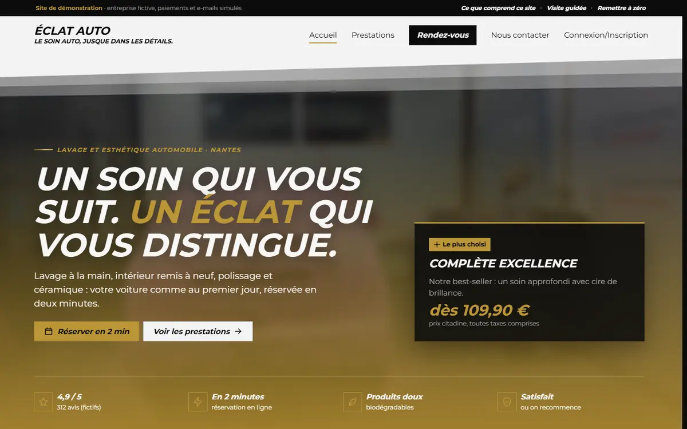</a>
</p>

<p align="center">
  <a href="https://eclat-auto.djason-chery.dev" title="Open the live demo"></a>
  
  
  
  
  
  <a href="LICENSE" title="Read the license"></a>
</p>

<p align="center">
  <a href="https://eclat-auto.djason-chery.dev" title="Open the live demo"><b>LIVE DEMO</b></a> &nbsp;&nbsp;·&nbsp;&nbsp;
  <a href="#what-the-demo-shows" title="Go to the features"><b>FEATURES</b></a> &nbsp;&nbsp;·&nbsp;&nbsp;
  <a href="docs/en/architecture.md" title="Read the documentation in English"><b>DOCUMENTATION</b></a> &nbsp;&nbsp;·&nbsp;&nbsp;
  <a href="README.fr.md" title="Lire cette page en français"><b>FRANÇAIS</b></a>
</p>

# Éclat Auto

**English** · [Français](README.fr.md "Lire cette page en français")

Demo site of **Éclat Auto**, a **fictional** car wash and detailing workshop in Nantes (France): services and prices,
online booking in 6 steps, customer area, offer for companies and a full administration.

It is a portfolio project by [Djason CHERY](https://djason-chery.dev "Djason CHERY's website"): the SvelteKit rebuild
of a real site made earlier, where every trace of the real client was replaced by invented content. **Nothing is
real**: the business, the people, the address, the reviews and the figures are invented; payments and e-mails are
simulated. The site is in French.

The design keeps the spirit of the original site (black, light grey and gold, bold italic titles, the original slanted
dividers) in a more premium version, with no other slanted shape.

**Live demo: [eclat-auto.djason-chery.dev](https://eclat-auto.djason-chery.dev "Open the live demo")**

## What the demo shows

| Part | Features |
| --- | --- |
| Home | Hero with trust badges and a "most chosen" card, "how it works" in 4 steps, prices by category, before / after slider of a headlight (mouse, finger or keyboard), options, reviews (fictional, said on the page), offer for companies, FAQ, final call to action |
| Services | Category filters, formulas compared side by side ("Recommended" badge), supplements by vehicle size, options |
| Booking | 6 steps: service, vehicle (pictograms, adjusted price) and formula, options, details, month calendar with free hours grouped morning / afternoon, editable summary and simulated payment. The total follows live (side panel, bottom bar on phones). Confirmation with an `.ics` calendar file and an e-mail preview |
| Companies | Benefits, three plans (one-off, fleet subscription, dealership), cards per trade, steps, fictional figures and testimonial, FAQ, quote request |
| Sign in | "Connexion / Inscription" window (simulated password reset), one-click demo accounts |
| Account | Dashboard (next appointment, upcoming, done, total paid), details, documents (images compressed in the browser), bookings with cancellation, account deletion |
| Administration | Key figures, bookings (status filters, search, confirm, cancel), users, slots calendar and week hours (Open / Closed switch), prices, messages |
| Information pages | Opening hours and access (drawn map, no third-party service), contact, legal notice, privacy, terms and cookies with a table of contents, 404 page |
| What this site includes | Page `/fonctionnalites/` (demo banner and footer): every feature by area (showcase, booking, customer area, admin, pros and contact, legal pages, quality), each with a direct link to its screen or to the sign-in window, what is simulated and what would become real, then "Vous voulez le même site ?" |
| Demo tools | "Site de démonstration" banner with "Ce que comprend ce site", a guided tour and "Remettre à zéro" (reset) |

<table>
  <tr>
    <th width="50%">Booking: vehicle and formula</th>
    <th width="50%">Booking: date and time</th>
  </tr>
  <tr>
    <td width="50%">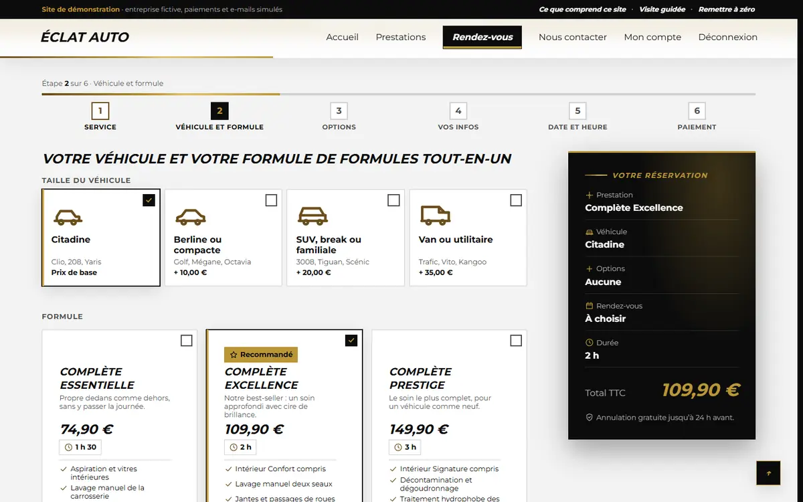</td>
    <td width="50%">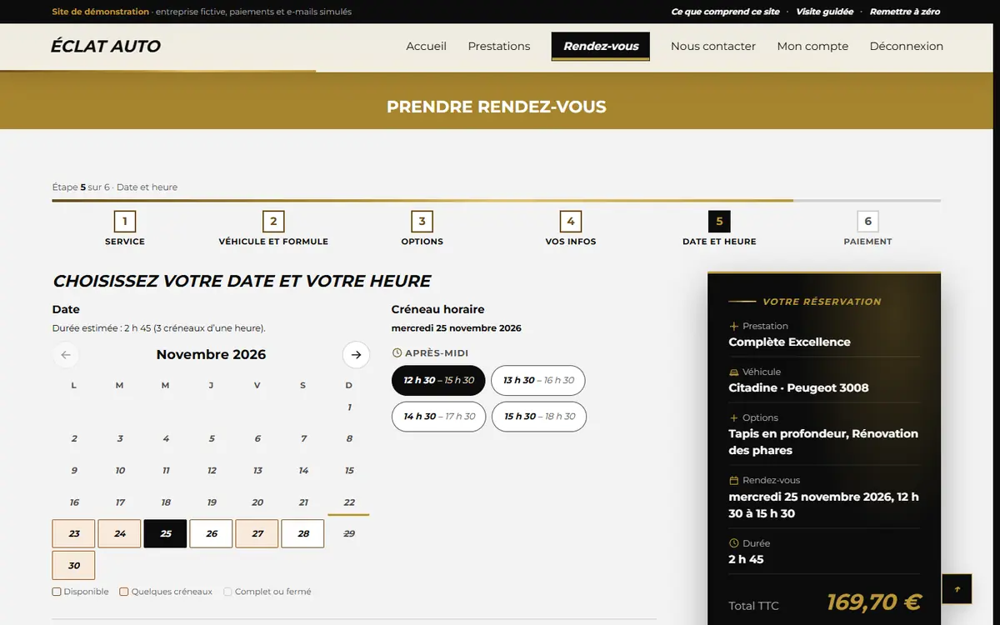</td>
  </tr>
  <tr>
    <th width="50%">Booking: summary</th>
    <th width="50%">Confirmation</th>
  </tr>
  <tr>
    <td width="50%">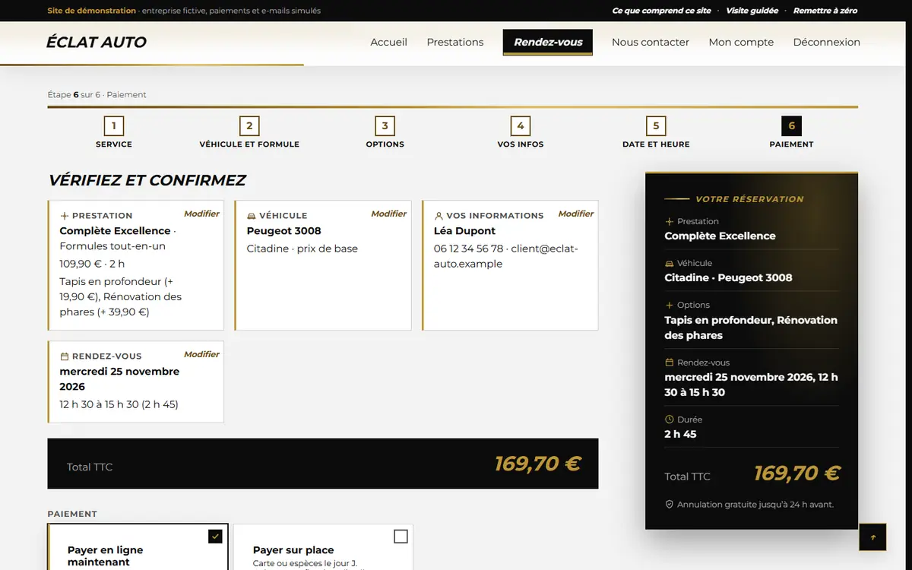</td>
    <td width="50%">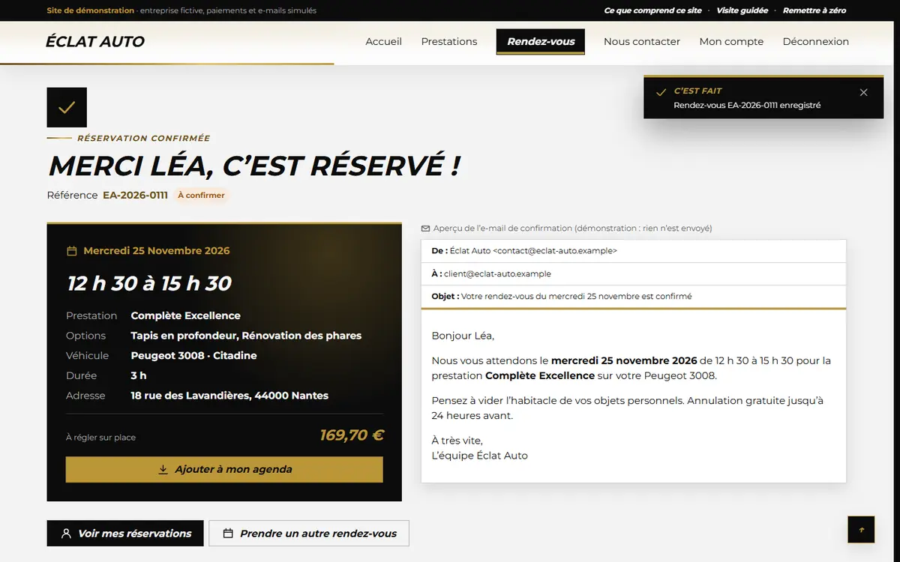</td>
  </tr>
  <tr>
    <th width="50%">Services</th>
    <th width="50%">Companies</th>
  </tr>
  <tr>
    <td width="50%">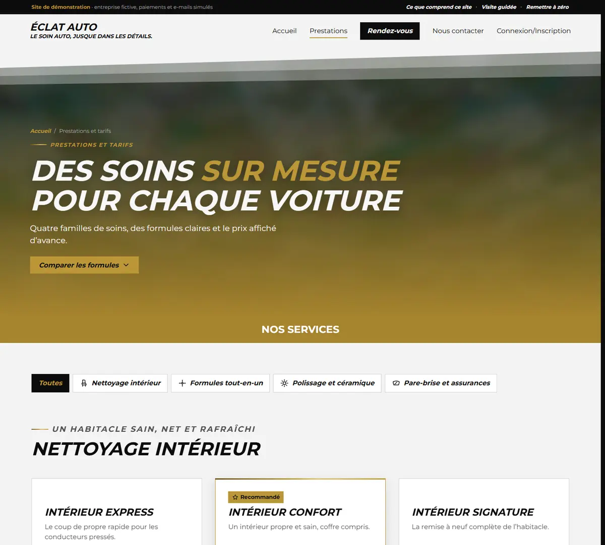</td>
    <td width="50%">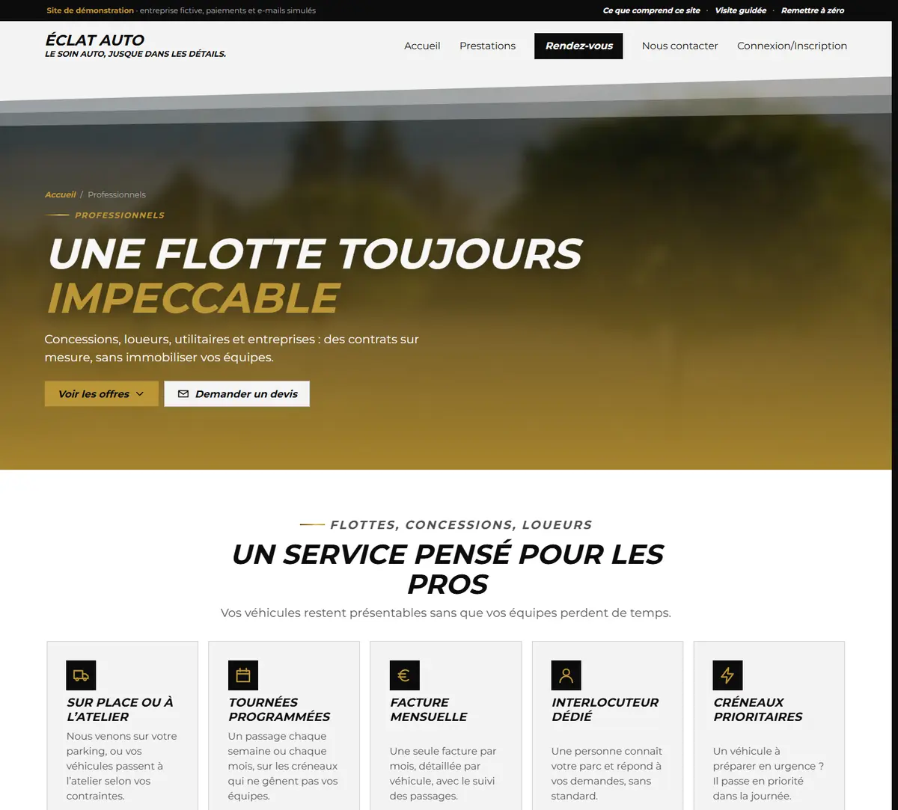</td>
  </tr>
  <tr>
    <th width="50%">Opening hours and access</th>
    <th width="50%">What this site includes</th>
  </tr>
  <tr>
    <td width="50%">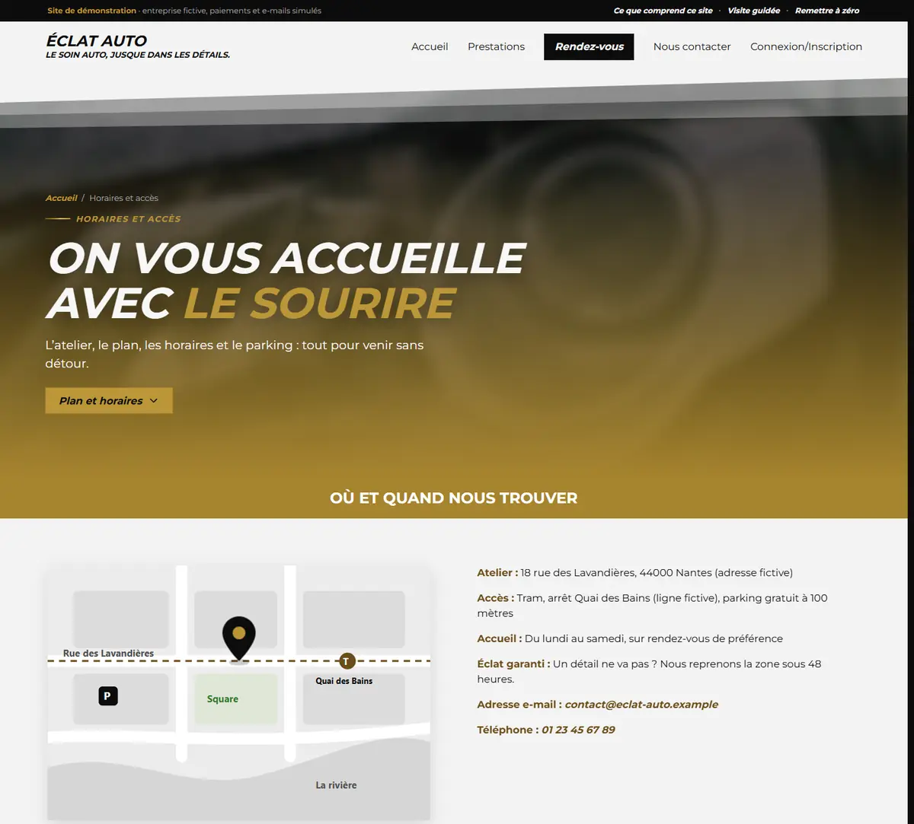</td>
    <td width="50%">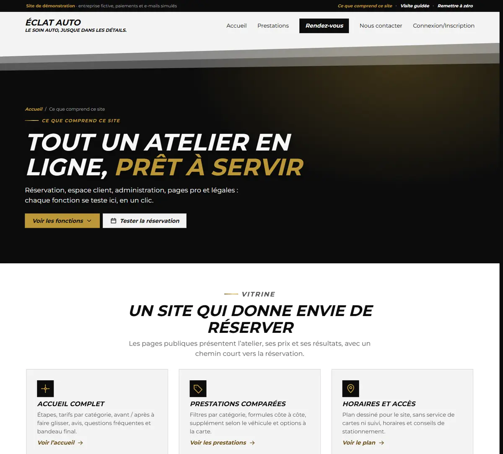</td>
  </tr>
  <tr>
    <th width="50%">Account</th>
    <th width="50%">Administration</th>
  </tr>
  <tr>
    <td width="50%">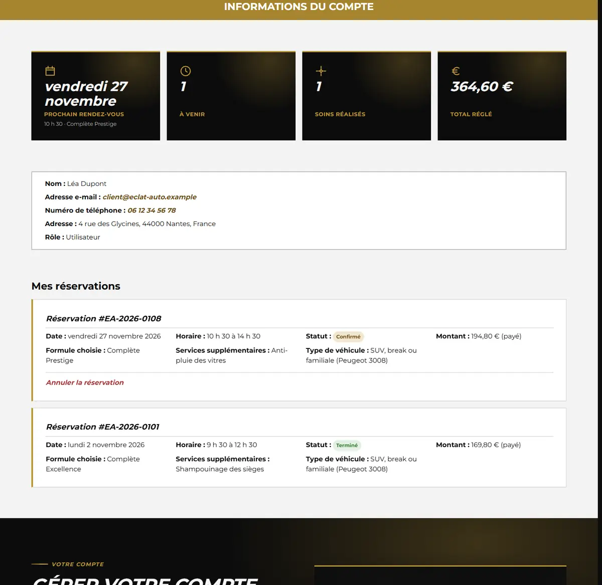</td>
    <td width="50%">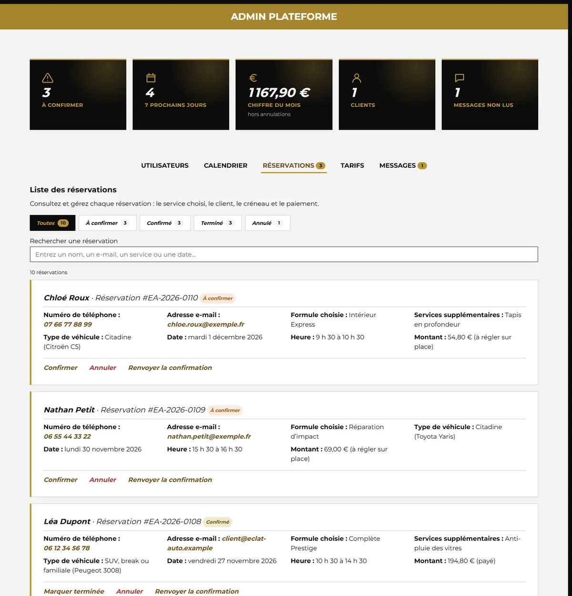</td>
  </tr>
</table>

<table>
  <tr>
    <th width="50%">Phone</th>
    <th width="50%">Menu</th>
  </tr>
  <tr>
    <td width="50%" align="center">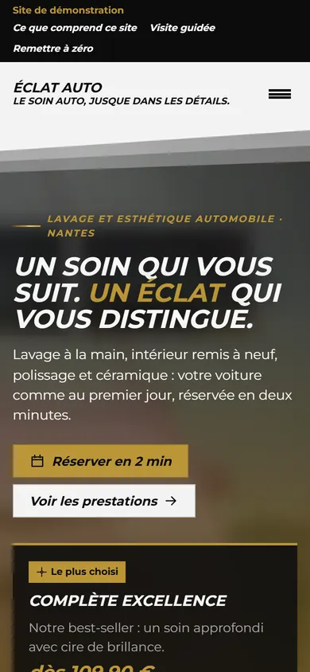</td>
    <td width="50%" align="center">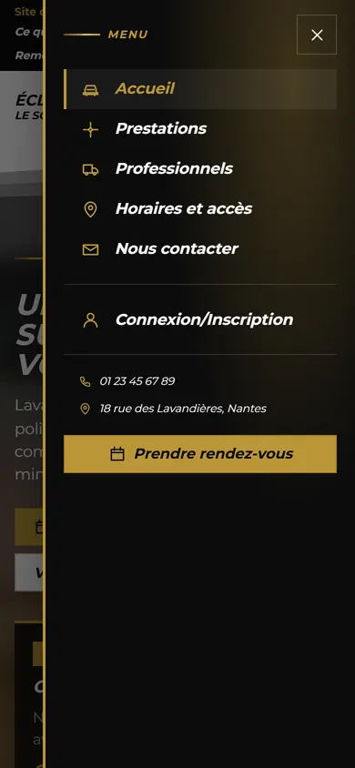</td>
  </tr>
</table>

### What is simulated

There is no server and no database. Accounts, bookings, slots, prices, messages and admin settings live in the
browser's `localStorage` (prefix `eclat-auto:`), with the rules of a real application (really free slots, cancellation
up to 24 hours before, customer and admin roles). Passwords are stored as SHA-256 hashes. E-mails are never sent: a
preview is shown. "Remettre à zéro", at the top of every page, brings back the starting data. Details:
[docs/en/demo-layer.md](docs/en/demo-layer.md "Demo layer").

### Demo accounts

Also as buttons in the sign-in window.

| Role | E-mail | Password |
| --- | --- | --- |
| Customer | `client@eclat-auto.example` | `Demo-Client-2026` |
| Admin | `admin@eclat-auto.example` | `Demo-Admin-2026` |

Test cards of the simulated payment: `4242 4242 4242 4242` is accepted, `4000 0000 0000 0002` is declined. No payment
provider is contacted.

## Stack

- [SvelteKit](https://svelte.dev "SvelteKit") and Svelte 5 (runes), strict **TypeScript**, exported as a **static
  site** (`adapter-static`): no server, no database
- State in Svelte stores (`src/lib/stores/`) and their actions (`stores/actions/`), data in `localStorage`
- Plain CSS with design tokens (`src/lib/assets/css/utils/variables.css`), self-hosted Montserrat font, inline SVG icons
- Structure of **[DC Scaffold](https://tools.djason-chery.dev/en/scaffold/ "Discover DC Scaffold")**, the author's project
  generator (one file per page, views in `components/views/`, reusable components in `components/ui/`)

## Run it

Node.js 20 or newer is needed.

```bash
cd frontend
npm install
npm run dev        # http://localhost:3000
```

On Windows, `start.bat` then `D` does the same (and installs what is missing). macOS and Linux: `./start.sh`.

Settings are in `frontend/.env` (development) and `frontend/.env.production` (build): copy `frontend/.env.example`.
They only hold the name and address of the site; no secret is needed.

## Scripts and checks

Run in `frontend/`. All of them must end with no error and no warning.

| Command | Role |
| --- | --- |
| `npm run dev` | Development site on http://localhost:3000 |
| `npm run check` | Types (svelte-check, strict TypeScript), plus the two checks below |
| `npm run check:images` | Every photo of `static/images/` is used in one place only, none is duplicated or unused |
| `npm run check:tokens` | No font size or spacing written by hand outside `variables.css` |
| `npm run lint` | ESLint |
| `npm run build` | Static site in `frontend/build/`, with `sitemap.xml`, `robots.txt`, `_headers` (CSP) and `404.html` |

## Folders

```text
frontend/
  src/routes/                 one page per folder (French addresses: /prestations/, /reservation/...)
  src/lib/components/layout/  frame of the pages: header, mobile menu, footer
  src/lib/components/ui/      reusable components (buttons, cards, heroes, sections, windows, fields...)
  src/lib/components/views/   content of each page (Home, Booking, Pros, Account, Admin, Legal...)
  src/lib/content/            texts and data: business, catalog, photos and credits, home, companies
  src/lib/demo/               starting data and local storage of the demo
  src/lib/stores/             application state and its actions (session, booking, admin, windows)
  src/lib/utils/              helpers: formats, slots, validation, .ics file, reveals...
  src/lib/assets/css/         styles: tokens, base, one file per family of components
  static/                     photos, font, icons, Cloudflare Pages _headers
  scripts/                    checks (images, tokens), sitemap, CSP
docs/                         detailed documentation (fr, en) and screenshots
```

More details: [docs/en/architecture.md](docs/en/architecture.md "Architecture").

## Conventions

- **Tokens everywhere**: every font size (`--font-*`) and spacing (`--space-*`) comes from `utils/variables.css`,
  enforced by `npm run check:tokens`.
- **One photo, one place**: enforced by `npm run check:images`.
- **Aligned card rows**: in a row of cards the same parts line up (badge, title, text, price, list, button at the
  bottom): container `aligned-cards` with `--card-rows`, cards `aligned-card` sharing the grid rows (`subgrid`); a
  missing part keeps its place with `<span class="card-slot"></span>`; choice cards use `<ChoiceCard aligned>`.
- **Links**: never underlined; inside a text, accent color and bold (`text-link`, `icon-link`); the link to the current
  page has `aria-current="page"`; never inside brackets.
- **Hover and pressed states**: mouse only, inside `@media (hover: hover) and (pointer: fine)`.
- **Form errors**: one notification naming the first wrong field, red border on the fields, focus on the first one;
  no error text under the fields.
- **No slanted shapes** added: only the original `ShapeDivider` remains.
- **End of page**: the last section before the footer is dark; a form goes there in a light card (`light-card`).
- **Windows** never move the page: only the window scrolls.
- **Accessibility**: down to 320 px wide and tall, keyboard everywhere, AA contrast, every link has a `title`, every
  image an `alt` and a `title`.

## Deploy

The demo is live on **Cloudflare Pages**, project `eclat-auto`, at
**[eclat-auto.djason-chery.dev](https://eclat-auto.djason-chery.dev "Open the live demo")** (a CNAME record at
Infomaniak points to `eclat-auto.pages.dev`). One-command deploy:

```bash
cd frontend && npm run build && npx wrangler pages deploy build --project-name eclat-auto --branch master
```

Full steps (project creation, domain, settings for a Git repository, security headers):
[docs/en/deployment.md](docs/en/deployment.md "Deployment").

## Documentation

| Topic | English | Français |
| --- | --- | --- |
| Architecture | [architecture.md](docs/en/architecture.md "Architecture") | [architecture.md](docs/fr/architecture.md "Architecture (français)") |
| Demo layer | [demo-layer.md](docs/en/demo-layer.md "Demo layer") | [couche-de-demo.md](docs/fr/couche-de-demo.md "Couche de démo (français)") |
| Deployment | [deployment.md](docs/en/deployment.md "Deployment") | [mise-en-ligne.md](docs/fr/mise-en-ligne.md "Mise en ligne (français)") |
| Credits | [credits.md](docs/en/credits.md "Credits") | [credits.md](docs/fr/credits.md "Crédits (français)") |

## License

Code shown for demonstration, **all rights reserved**: no reuse without written permission, see [LICENSE](LICENSE "License")
(licence on request: [djason-chery.dev](https://djason-chery.dev "Djason CHERY's website")).

## Credits

- Photos: Wikimedia Commons, under free licenses (CC BY, CC BY-SA, CC0, public domain), cropped, blurred and darkened;
  the full list is in the legal notice of the site and in [docs/en/credits.md](docs/en/credits.md "Credits").
- Font: [Montserrat](https://fonts.google.com/specimen/Montserrat "Montserrat on Google Fonts"), by Julieta Ulanovsky
  and contributors, under the SIL Open Font License 1.1 (`frontend/static/fonts/Montserrat-OFL.txt`).
- Access map: vector drawing made for the demo.
- Design and development: [Djason CHERY](https://djason-chery.dev "Djason CHERY's website"), with
  [DC Scaffold](https://tools.djason-chery.dev/en/scaffold/ "Discover DC Scaffold").
